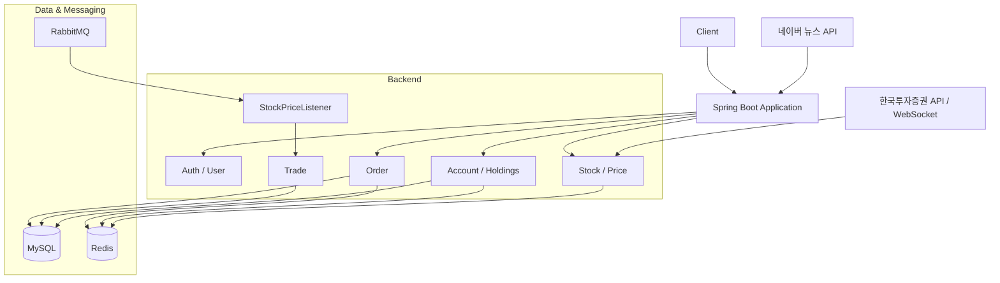

# Mockstalk

**Spring Boot 기반 모의 주식 투자 서비스**

실시간 주식 데이터를 활용해 사용자가 가상의 자산으로 주식을 거래하고, 주문부터 체결 및 자산 관리까지 경험할 수 있는 모의 투자 서비스입니다.

주문 유형에 따른 체결 처리, Redis 기반 데이터 관리, RabbitMQ를 활용한 비동기 메시지 처리 등을 구현했습니다.

<br>

## 1. Project Overview

### 프로젝트 소개

Mockstalk은 한국투자증권 Open API와 네이버 뉴스 검색 API를 연동한 모의 주식 투자 서비스입니다.

사용자는 계좌를 생성하고 주식 시세를 확인한 뒤 시장가 및 지정가 주문을 통해 모의 거래를 진행할 수 있습니다. 체결 내역과 보유 종목을 조회할 수 있으며, 관심 종목과 커뮤니티 등 투자에 필요한 기능도 제공합니다.

단순히 주문 요청을 저장하는 데 그치지 않고, 주문 상태에 따른 체결 처리와 계좌 잔고 반영까지 이어지는 백엔드 흐름을 구현하는 데 중점을 두었습니다.

| 항목 | 내용 |
|---|---|
| 프로젝트명 | Mockstalk |
| 프로젝트 유형 | 모의 주식 투자 서비스 |
| 개발 기간 | 2025.05 ~ 2025.07 |
| 팀 구성 | 6인 |
| 담당 역할 | 팀장 및 백엔드 개발 |
| 주요 기술 | Java, Spring Boot, MySQL, Redis, RabbitMQ, Redisson |

### 주요 기능

- **회원 및 인증:** 회원가입, 로그인, JWT 기반 인증 및 토큰 재발급
- **주식 데이터:** 한국투자증권 Open API 기반 시세 및 차트 데이터 조회
- **주문 및 체결:** 시장가·지정가 매수/매도 주문과 체결 내역 관리
- **계좌 관리:** 계좌 생성, 잔고 및 보유 종목 조회
- **자산 랭킹:** 사용자별 수익률을 기준으로 랭킹 제공
- **관심 종목:** 계좌별 관심 종목 등록 및 관리
- **커뮤니티:** 종목별 게시글과 댓글
- **뉴스:** 네이버 뉴스 검색 API 연동

<br>

## 2. System Architecture

### 전체 시스템 구성

서비스는 Spring Boot 애플리케이션을 중심으로 MySQL, Redis, RabbitMQ를 연결하는 구조로 구성했습니다.

외부 API를 통한 주식 데이터 수집과 애플리케이션 내부의 주문·체결 처리를 분리하고, Redis를 이용해 시세와 주문 관련 데이터를 관리합니다.



> 위 다이어그램은 전체 구성 요소를 나타낸 개략도입니다. 실제 시세 수신 경로와 RabbitMQ 테스트 시세 처리 경로는 아래 메시지 흐름에서 구분합니다.

### 주문 및 체결 데이터 흐름

**시장가 주문**

```text
Client
  → MarketOrderController
  → MarketOrderService
  → TradeService.tradeOrder()
  → MySQL
```

시장가 주문은 Redis에 저장된 현재가를 활용해 주문 처리를 진행하고, 체결 서비스로 전달합니다.

**지정가 주문**

```text
Client
  → LimitOrderService
  → 주문 정보 저장
  → Redis 대기 주문 목록 등록
  → 시세 업데이트
  → TradeService.onPriceUpdated()
  → TradeService.tradeOrder()
  → MySQL
```

지정가 주문은 체결 조건이 충족될 때까지 Redis에 종목별 대기 주문 목록으로 관리합니다.

**RabbitMQ 테스트 시세 처리**

```text
POST /api/test/price
  → TestPricePublishService
  → Redis 시세 저장
  → RabbitMQ Exchange
  → Queue
  → StockPriceListener
  → TradeService.onPriceUpdated()
  → 체결 처리
```

현재 구현에서는 테스트 시세 API가 RabbitMQ 메시지를 발행하는 진입점입니다. 한국투자증권 WebSocket 시세 수신 경로는 Redis 갱신까지 연결되어 있으며, RabbitMQ 발행과는 별도로 동작합니다.

<br>

## 3. Tech Stack

| 구분 | 기술 | 사용 목적 |
|---|---|---|
| Language | Java 17 | 백엔드 애플리케이션 개발 |
| Framework | Spring Boot 3.5 | REST API 및 서비스 구성 |
| Security | Spring Security, JWT | 인증 및 접근 제어 |
| ORM | Spring Data JPA | 데이터 접근 및 영속성 관리 |
| Query | QueryDSL | 주문 및 체결 데이터 조회 |
| Database | MySQL 8 | 사용자, 계좌, 주문, 체결 데이터 관리 |
| Cache | Redis | 실시간 시세, 토큰, 대기 주문 및 랭킹 관리 |
| Messaging | RabbitMQ | 시세 이벤트 전달 및 비동기 처리 |
| Concurrency | Redisson | 주문 단위 분산 락 |
| External API | 한국투자증권 Open API | 주식 시세 및 차트 데이터 |
| External API | 네이버 뉴스 API | 뉴스 검색 |
| Container | Docker, Docker Compose | 애플리케이션 및 로컬 인프라 구성 |
| CI/CD | GitHub Actions | 이미지 빌드 및 배포 자동화 |
| Infrastructure | AWS ECR, ECS Fargate | 컨테이너 이미지 저장 및 서비스 배포 |
| Test | JUnit 5, Mockito, AssertJ | 단위 및 서비스 테스트 |
| Test | H2, Testcontainers | 테스트용 데이터베이스 및 통합 테스트 |

<br>

## 4. Core Features

### 4.1 회원 및 인증

- 회원가입 및 로그인
- JWT 기반 인증 및 인가
- Access Token 및 Refresh Token 관리
- 로그아웃 및 토큰 재발급
- Redis를 활용한 토큰 블랙리스트 관리

### 4.2 주식 데이터

- 한국투자증권 Open API를 통한 현재가 조회
- WebSocket을 통한 실시간 체결 데이터 수신
- 일봉·주봉·월봉 등 기간별 차트 데이터 조회
- 분봉 데이터 조회
- Redis를 활용한 시세 데이터 관리

### 4.3 주문 및 체결

- 시장가 매수 및 매도
- 지정가 매수 및 매도
- 지정가 조건에 따른 체결 처리
- 주문 상태 관리
- 체결 내역 조회
- 체결 결과에 따른 계좌 잔고 및 보유 종목 반영

### 4.4 계좌 및 자산 관리

- 계좌 생성 및 인증
- 계좌별 잔고 조회
- 보유 종목 및 수량 조회
- 총자산 및 수익률 조회
- 사용자별 수익률 랭킹

### 4.5 관심 종목 및 커뮤니티

- 관심 종목 등록 및 삭제
- 종목별 게시글 작성 및 조회
- 댓글 작성 및 관리
- 네이버 뉴스 검색 결과 제공

<br>

## 5. Technical Highlights

### 5.1 RabbitMQ를 활용한 시세 이벤트 처리

**적용 배경**

시세 업데이트와 주문 체결 처리를 분리할 수 있도록 메시지 기반 처리 구조를 구성했습니다.

**구현 내용**

- `stock.exchange` Exchange 구성
- `stock.price` Routing Key를 이용한 메시지 전달
- `stock.price` Queue 구성
- `StockPriceEventDto`를 통한 종목 ID 및 현재가 전달
- `StockPriceListener`에서 메시지를 수신하고 체결 서비스 호출

테스트 시세 API에서 가격 정보를 Redis에 저장한 뒤 RabbitMQ로 이벤트를 발행하도록 구현했습니다.

Consumer는 메시지를 수신한 뒤 `TradeService.onPriceUpdated()`를 호출하여 해당 종목의 지정가 주문 체결 조건을 확인합니다.

**관련 코드**

- `RabbitConfig`
- `TestPricePublishService`
- `StockPriceEventDto`
- `StockPriceListener`
- `TradeService`

### 5.2 Redis 기반 시세 및 지정가 주문 관리

**적용 배경**

시세와 주문 관련 데이터를 매번 데이터베이스에서 조회하는 대신, 자주 접근하는 데이터를 Redis에 저장해 활용하도록 구성했습니다.

**구현 내용**

| Redis Key | 용도 |
|---|---|
| `stockPrice::{종목코드}` | 현재 주가 저장 |
| `completeOrders:{stockId}` | 종목별 지정가 대기 주문 ID 목록 |
| `accessToken::koreainvestment` | 한국투자증권 접근 토큰 |
| `approvalKey::koreainvestment` | WebSocket 승인 키 |
| `userProfitRanking` | 사용자 수익률 랭킹 |
| `accountAsset::{accountId}` | 계좌 총자산 캐시 |
| `accountProfitRate::{accountId}` | 계좌 수익률 캐시 |

지정가 주문은 종목 ID를 기준으로 Redis 리스트에 관리합니다. 시세가 갱신되면 해당 종목의 대기 주문 ID를 가져와 실제 주문 정보를 조회하고 체결 조건을 확인합니다.

앱 시작 시에는 데이터베이스에 저장된 대기 주문을 Redis에 다시 적재하도록 구성했습니다.

**관련 코드**

- `CompleteOrderRedisCache`
- `TradeService`
- `RedisCacheConfig`
- `AccountService`
- `RankService`

### 5.3 Redisson을 활용한 주문 동시성 제어

**적용 배경**

동일한 주문이 여러 경로에서 동시에 체결 처리를 요청하는 경우, 중복 처리가 발생하지 않도록 주문 단위의 동시성 제어가 필요했습니다.

**구현 내용**

- `@DistributedLock` 커스텀 어노테이션 적용
- 주문 ID를 기준으로 락 키 생성
- Redisson을 이용한 분산 락 획득
- 락 획득 후 주문 상태 확인 및 체결 처리
- 트랜잭션 처리가 끝난 뒤 락 해제

락 키는 `trade:{주문 ID}` 형태로 구성하여 서로 다른 주문이 불필요하게 같은 락을 기다리지 않도록 했습니다.

또한 `TradeService` 내부에서 자기 자신의 메서드를 호출할 때 Spring AOP가 적용되지 않는 문제를 고려해 `ObjectProvider`를 통해 프록시 객체를 호출하도록 구성했습니다.

**관련 코드**

- `DistributedLock`
- `DistributedLockAspect`
- `TradeService`

<br>

## 6. Performance & Optimization

성능 개선과 관련해서는 기존 구조와 변경된 구조를 비교하고, 실제 측정 조건을 기준으로 결과를 정리합니다.

현재 저장소에서 확인되는 최적화 항목은 다음과 같습니다.

| 개선 영역 | 적용 내용 |
|---|---|
| 지정가 주문 조회 | Redis에 종목별 주문 ID 목록 관리 |
| 계좌 정보 조회 | Redis 캐시와 TTL 적용 |
| 주문 및 체결 조회 | QueryDSL 기반 커서 페이지 조회 |
| 동시성 제어 | 주문 ID 단위 Redisson 분산 락 |

성능 수치와 테스트 환경은 별도 측정 자료를 확인한 뒤 추가할 예정입니다.

<br>

## 7. Team & Contribution

### 팀 구성

- 6인 팀 프로젝트
- 백엔드 및 프론트엔드 기능을 분담하여 개발
- 기능별 개발 일정과 진행 상황을 조율하며 프로젝트 진행

### 개인 담당 업무

**팀장 / 백엔드 개발**

주문 및 체결 영역을 중심으로 백엔드 기능을 개발했습니다.

- 시장가 및 지정가 주문 처리
- 주문 상태에 따른 체결 로직
- 주문 및 체결 데이터 관리
- Redis 기반 지정가 대기 주문 관리
- RabbitMQ 기반 테스트 시세 이벤트 처리
- Redisson을 활용한 주문 단위 분산 락 적용
- 주문 및 체결 조회 API 개발

프로젝트 전체 기능은 팀원들과 분담하여 개발했으며, 위 항목은 개인 담당 영역을 중심으로 정리했습니다.

<br>

## 8. Getting Started

### Requirements

- JDK 17
- Docker
- Docker Compose

### 1. Repository Clone

```bash
git clone https://github.com/jihwanprogramer/mock-trading-springboot.git
cd mock-trading-springboot
```

### 2. Infrastructure 실행

```bash
docker compose up -d mysql redis rabbitmq
```

### 3. 환경 변수 설정

애플리케이션 실행에 필요한 환경 변수를 설정합니다.

```properties
DB_HOST=
DB_PORT=
DB_NAME=
DB_USERNAME=
DB_PASSWORD=

REDIS_HOST=
REDIS_PORT=

RABBITMQ_HOST=
RABBITMQ_PORT=
RABBITMQ_USERNAME=
RABBITMQ_PASSWORD=

JWT_SECRET=
ACCOUNT_JWT_SECRET=

HANTU_APPKEY=
HANTU_APPSECRET=
HANTU_ACCESS_TOKEN=

NAVER_CLIENT_ID=
NAVER_CLIENT_SECRET=
```

실제 인증 정보는 저장소에 포함하지 않습니다.

### 4. Application 실행

```bash
./gradlew bootRun --args='--spring.profiles.active=local'
```

애플리케이션 기본 포트는 `8081`입니다.

### 5. Test

```bash
./gradlew test
```

테스트 프로파일에서는 H2 데이터베이스를 사용하도록 구성되어 있습니다.

### 6. 테스트 시세 이벤트 발행

애플리케이션 실행 후 테스트 시세 API를 통해 체결 이벤트 흐름을 확인할 수 있습니다.

```http
POST /api/test/price?stockId={stockId}&currentPrice={currentPrice}
```

이 API는 개발 및 검증을 위한 엔드포인트이며, 운영 환경에서는 별도의 접근 제어가 필요합니다.

<br>

## 9. Retrospective

Mockstalk을 개발하면서 주문 요청을 처리하는 것과 실제 체결 결과를 일관되게 반영하는 것은 별개의 문제라는 점을 경험했습니다.

특히 지정가 주문은 주문이 접수된 시점과 실제 체결되는 시점이 다르기 때문에 주문 상태와 계좌 잔고를 함께 고려해야 했습니다.

또한 여러 요청이 동일한 주문을 처리할 수 있는 상황을 고려해 주문 단위 분산 락을 적용했고, 시세 이벤트를 전달하는 과정에서는 RabbitMQ를 활용한 메시지 처리 구조를 구성했습니다.

프로젝트를 통해 단순히 API를 구현하는 것뿐 아니라, 데이터가 어떤 경로로 전달되고 최종적으로 어떻게 저장되는지까지 고려하는 것이 백엔드 개발에서 중요하다는 점을 배웠습니다.

<br>

---

### Further Improvements

- 실제 WebSocket 시세 수신부터 RabbitMQ 체결 이벤트까지의 연결 구조 개선
- 메시지 재처리 및 실패 메시지 관리 정책 보완
- 주문 및 체결 데이터의 정합성 검증 강화
- 동시 요청 및 부하 테스트를 통한 성능 측정
- 테스트 시세 API의 운영 환경 접근 제어
