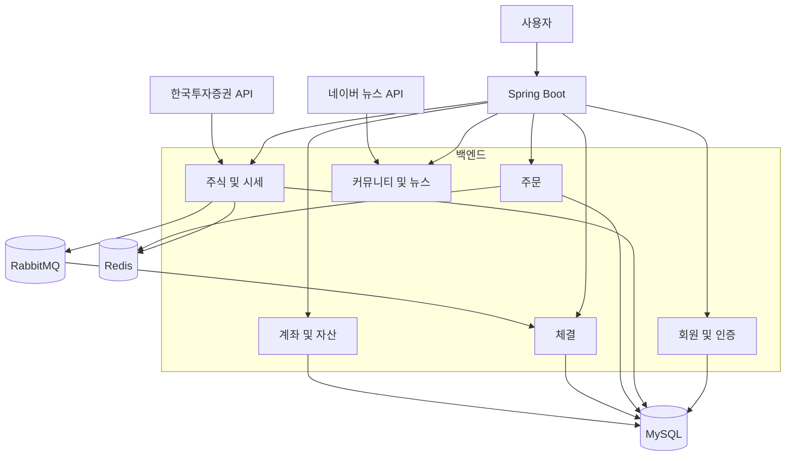
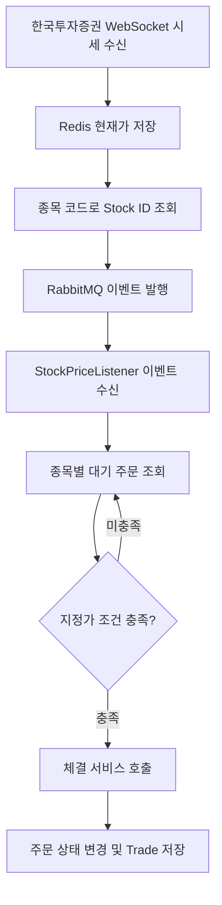

# Mockstalk

**실시간 주식 데이터를 활용한 모의 투자 서비스**

가상의 자산으로 주식을 거래하고, 주문부터 체결 및 자산 관리까지 경험할 수 있는 모의 투자 플랫폼입니다.

한국투자증권 Open API를 통해 주식 시세를 수신하고, Redis와 RabbitMQ를 활용해 지정가 주문을 처리합니다.

<p align="center">
  
  
  
  
  
  
</p>

---

## 1. 프로젝트 소개

| 구분 | 내용 |
|:---:|---|
| 프로젝트명 | Mockstalk |
| 개발 기간 | 2025.05 ~ 2025.07 |
| 팀 구성 | 6인 |
| 담당 역할 | 팀장 / 백엔드 개발 |
| 주요 담당 | 주문·체결 처리, 주문 데이터 관리, 동시성 제어 |

### 주요 기능

- 회원가입 및 JWT 기반 인증
- 실시간 주식 시세 및 차트 조회
- 시장가·지정가 매수 및 매도
- 주문 체결 및 계좌 잔고 관리
- 수익률 기반 자산 랭킹
- 관심 종목 및 커뮤니티
- 주식 관련 뉴스 조회

## 2. 시스템 구조

### 전체 시스템 구성



### 지정가 주문 처리 흐름

시세 수신부터 주문 체결까지의 흐름입니다.



**주문 유형별 처리 방식**

| 구분 | 처리 흐름 |
|---|---|
| 시장가 주문 | Redis 현재가 조회 → 체결 서비스 직접 호출 |
| 지정가 주문 | Redis 대기 주문 관리 → RabbitMQ 이벤트 → 체결 조건 확인 |

## 3. 기술 스택

| 구분 | 기술 | 사용 목적 |
|---|---|---|
| 언어 | Java 17 | 백엔드 개발 |
| 프레임워크 | Spring Boot 3.5 | 서버 및 REST API |
| 인증 | Spring Security, JWT | 인증 및 인가 |
| ORM | Spring Data JPA | 데이터 접근 |
| 쿼리 | QueryDSL | 동적 쿼리 및 페이징 |
| 데이터베이스 | MySQL 8.0 | 서비스 데이터 저장 |
| 캐시 | Redis | 현재가 및 대기 주문 관리 |
| 메시징 | RabbitMQ | 시세 이벤트 비동기 처리 |
| 동시성 제어 | Redisson | 주문 단위 분산 락 |
| 외부 API | 한국투자증권, 네이버 검색 API | 주식 시세 및 뉴스 |
| 배포 | Docker, GitHub Actions, AWS ECR, ECS Fargate | 빌드 및 배포 |
| 테스트 | JUnit 5, Mockito, AssertJ, Testcontainers | 단위 및 통합 테스트 |

## 4. 핵심 기술 문제 해결

프로젝트를 개발하면서 주문 처리 과정에서 발생할 수 있는 DB 조회 부담, 중복 체결, 메시지 재전달 문제를 해결했습니다.

### 01. 반복적인 DB 조회를 줄이기 위한 이벤트 기반 체결 구조

<details>
<summary><b>문제 상황</b></summary>

기존에는 일정 주기마다 DB에서 미체결 주문을 조회하고 현재가와 비교하는 방식으로 지정가 주문을 처리했습니다.

이 방식은 주문이 증가할수록 반복적인 DB 조회가 발생할 수 있고, 시세가 변경되지 않은 상황에서도 주문을 확인하게 되는 문제가 있었습니다.

</details>

**해결 과정**

1. 지정가 주문을 Redis의 종목별 대기 목록에 저장
2. WebSocket으로 수신한 시세를 Redis에 저장
3. 시세 정보를 RabbitMQ 이벤트로 발행
4. Listener에서 이벤트를 수신해 해당 종목의 대기 주문 조회
5. 지정가 조건을 충족한 주문만 체결 서비스 호출

**처리 흐름**

```text
WebSocket
    ↓
Redis 현재가 저장
    ↓
RabbitMQ 이벤트 발행
    ↓
StockPriceListener
    ↓
대기 주문 조회 및 체결 조건 확인
    ↓
TradeService
```

**결과**

주기적으로 DB를 조회하던 방식에서 시세 이벤트를 기반으로 대기 주문의 체결 조건을 확인하는 구조로 변경했습니다.

---

### 02. 동시 이벤트로 발생하는 중복 체결 방지

<details>
<summary><b>문제 상황</b></summary>

동일한 주문에 여러 시세 이벤트가 동시에 전달되면 여러 요청이 체결 처리를 진행할 수 있었습니다.

단순히 주문 상태를 확인하는 것만으로는 동시에 진입한 요청을 막을 수 없었고, 실제 테스트에서 동일 주문에 Trade 데이터가 중복 생성되는 문제가 확인됐습니다.

</details>

**해결 과정**

| 단계 | 적용 내용 |
|:---:|---|
| 1 | 주문 ID를 기준으로 Redisson 분산 락 적용 |
| 2 | 락 획득 후 DB에서 주문 상태 재조회 |
| 3 | 이미 체결된 주문이면 추가 처리 중단 |
| 4 | TransactionTemplate으로 주문 상태 변경 및 Trade 저장 |
| 5 | 트랜잭션 커밋 이후 락 해제 |

**검증 결과**

동일 주문에 4개의 이벤트가 동시에 전달되는 상황을 테스트했습니다.

| 구분 | Trade 생성 건수 |
|:---:|---:|
| 수정 전 | 4건 |
| 수정 후 | **1건** |

중복 이벤트가 발생해도 하나의 주문에 하나의 체결 내역만 생성되는 것을 확인했습니다.

---

### 03. RabbitMQ 메시지 재전달에 따른 중복 처리 방지

<details>
<summary><b>문제 상황</b></summary>

체결 처리 중 예외가 발생하면 RabbitMQ 메시지가 재전달될 수 있습니다.

이미 체결된 주문이 다시 처리되면 동일한 거래 데이터가 중복 생성될 가능성이 있었습니다.

</details>

**해결 과정**

- 체결 처리 전 DB에서 주문 상태 재확인
- 이미 체결된 주문은 추가 처리하지 않도록 예외 처리
- 주문 상태 변경과 Trade 저장을 하나의 트랜잭션으로 처리
- 메시지가 재전달되는 상황을 구성해 최종 데이터 확인

**결과**

메시지 재전달 상황에서도 최종 주문 상태가 유지되고, 중복 Trade가 생성되지 않는 것을 확인했습니다.

## 5. 테스트 및 검증

실제 서비스에서 발생할 수 있는 주문 체결 상황을 검증하기 위해 단위 테스트와 Testcontainers 기반 통합 테스트를 작성했습니다.

### 테스트 환경

| 구분 | 환경 |
|---|---|
| 테스트 프레임워크 | JUnit 5, Mockito, AssertJ |
| 테스트 DB | H2 |
| 통합 테스트 | Testcontainers |
| 데이터베이스 | MySQL 8.0 |
| 캐시 | Redis 7 |
| 메시지 브로커 | RabbitMQ 3-management |

### 주요 검증 항목

| 검증 대상 | 확인 내용 |
|---|---|
| 시장가 주문 | 현재가 조회 및 매수·매도 체결 |
| 지정가 주문 | 매수·매도 가격 조건에 따른 체결 |
| 동시 이벤트 | 동일 주문의 중복 체결 방지 |
| 트랜잭션 | 실패 시 주문 상태 및 Trade 데이터 롤백 |
| 메시지 재전달 | 재전달 이후 중복 체결 방지 |
| 데이터 연동 | Redis 대기 주문과 DB 주문 데이터 연동 |

### 전체 테스트 결과

| 항목 | 결과 |
|---|---:|
| 테스트 스위트 | 30개 |
| 전체 테스트 | 100개 |
| 성공 | **100개** |
| 실패 | 0개 |
| 스킵 | 0개 |

Testcontainers를 통해 MySQL, Redis, RabbitMQ를 실제 컨테이너로 실행해 통합 테스트를 진행했습니다.

> **검증 범위:** 테스트 환경에서 주문 체결, 동시 이벤트, 트랜잭션 롤백 및 메시지 재전달을 확인했습니다. 실제 한국투자증권 WebSocket 연결과 다중 서버 인스턴스 환경의 운영 검증은 아직 진행하지 않았습니다.

## 6. 담당 업무

### 팀장 / 백엔드 개발

6인 팀 프로젝트에서 백엔드 개발과 팀 리딩을 담당했습니다.

**주요 구현 업무**

- 시장가·지정가 주문 API 구현
- 주문 상태에 따른 체결 처리 로직 구현
- Redis 기반 지정가 대기 주문 관리
- RabbitMQ 시세 이벤트 발행 및 지정가 체결 처리 흐름 구현
- Redisson 분산 락을 활용한 중복 체결 방지
- 주문 및 체결 데이터 정합성 테스트 작성

**팀 리딩**

- 팀원별 역할과 개발 일정 조율
- 작업 단위를 구체화하고 완료 기준 공유
- 진행 상황을 확인하며 일정 및 업무 범위 조정

## 7. 실행 방법

### 요구 사항

- JDK 17
- Docker
- Docker Compose

### 1. 저장소 복제

```bash
git clone https://github.com/jihwanprogramer/mock-trading-springboot.git
cd mock-trading-springboot
```

### 2. 인프라 실행

```bash
docker compose up -d mysql redis rabbitmq
```

### 3. 환경 변수 설정

| 환경 변수 | 설명 |
|---|---|
| DB_HOST, DB_PORT, DB_NAME | MySQL 접속 정보 |
| DB_USERNAME, DB_PASSWORD | MySQL 인증 정보 |
| REDIS_HOST, REDIS_PORT | Redis 접속 정보 |
| RABBITMQ_HOST, RABBITMQ_PORT | RabbitMQ 접속 정보 |
| RABBITMQ_USERNAME, RABBITMQ_PASSWORD | RabbitMQ 인증 정보 |
| JWT_SECRET, ACCOUNT_JWT_SECRET | JWT 서명 키 |
| HANTU_APPKEY, HANTU_APPSECRET | 한국투자증권 API 인증 정보 |
| HANTU_ACCESS_TOKEN | 한국투자증권 접근 토큰 |
| NAVER_CLIENT_ID, NAVER_CLIENT_SECRET | 네이버 API 인증 정보 |

실제 인증 정보는 저장소에 포함하지 않고 환경 변수로 설정해야 합니다.

### 4. 애플리케이션 실행

```bash
./gradlew bootRun --args='--spring.profiles.active=local'
```

기본 실행 포트: `8081`

### 5. 테스트 실행

```bash
./gradlew test
```

### 테스트용 시세 이벤트 API

```http
POST /api/test/price?stockId={stockId}&currentPrice={currentPrice}
```

해당 API는 RabbitMQ 이벤트만 발행합니다. 실제 WebSocket 수신 흐름과 달리 Redis 현재가는 갱신하지 않습니다.

---

## Repository

[GitHub - Mockstalk](https://github.com/jihwanprogramer/mock-trading-springboot)
