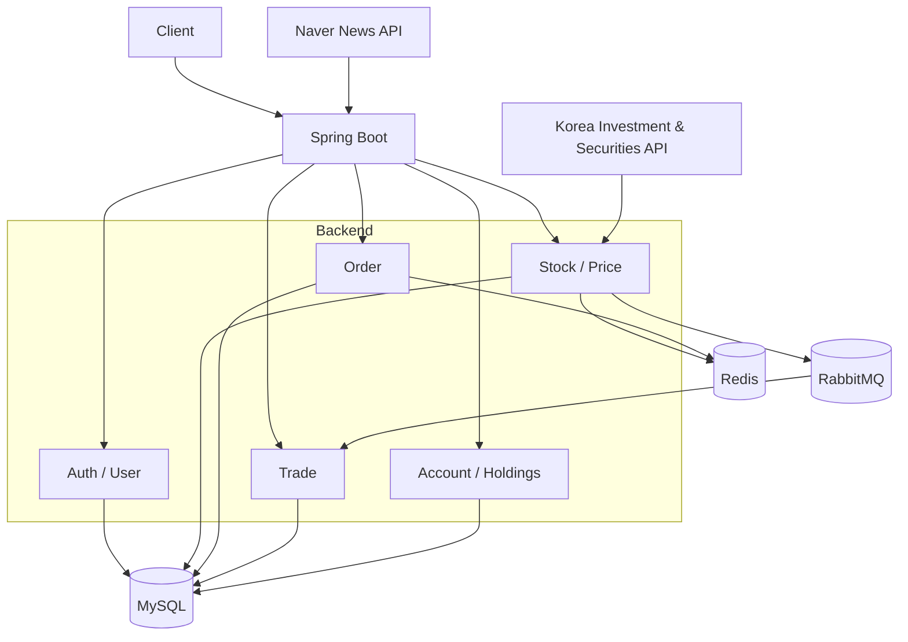
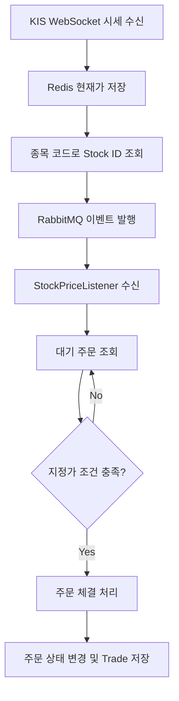

# Mockstalk

**Spring Boot 기반 모의 주식 투자 서비스**

실시간 주식 데이터를 활용해 가상의 자산으로 주식을 거래하고, 주문부터 체결 및 자산 관리까지 경험할 수 있는 모의 투자 서비스입니다.

한국투자증권 Open API와 WebSocket을 통해 주식 시세를 수신하고, Redis와 RabbitMQ를 활용해 지정가 주문의 체결을 처리합니다.

## 1. Project Overview

| 항목 | 내용 |
|---|---|
| 프로젝트 | Mockstalk |
| 개발 기간 | 2025.05 ~ 2025.07 |
| 팀 구성 | 6인 |
| 담당 역할 | 팀장 / 백엔드 개발 |
| 주요 담당 | 주문·체결 처리, 주문 데이터 관리, 동시성 제어 |

### 주요 기능

- 회원가입, 로그인 및 JWT 인증
- 실시간 주식 시세 및 차트 조회
- 시장가·지정가 매수 및 매도
- 주문 체결 및 계좌 잔고 관리
- 수익률 기반 자산 랭킹
- 관심 종목, 커뮤니티 및 뉴스 조회

## 2. Architecture

### System Architecture



### 지정가 주문 처리 흐름

실시간 시세를 Redis에 저장하고 RabbitMQ 이벤트로 전달해 지정가 주문 체결을 처리합니다.



시장가 주문은 Redis에 저장된 현재가를 조회한 뒤 체결 서비스를 직접 호출하며, 지정가 주문은 시세 이벤트를 통해 체결 조건을 확인합니다.

## 3. Tech Stack

| 구분 | 기술 | 활용 |
|---|---|---|
| Language | Java 17 | 백엔드 개발 |
| Framework | Spring Boot 3.5 | REST API 및 서비스 구현 |
| Security | Spring Security, JWT | 인증 및 인가 |
| ORM | Spring Data JPA | 데이터 접근 |
| Query | QueryDSL | 동적 쿼리 및 페이징 |
| Database | MySQL 8.0 | 서비스 데이터 저장 |
| Cache | Redis | 현재가, 대기 주문 및 캐시 관리 |
| Messaging | RabbitMQ | 시세 이벤트 비동기 처리 |
| Concurrency | Redisson | 주문 단위 분산 락 |
| External API | 한국투자증권, 네이버 검색 API | 주식 시세 및 뉴스 데이터 |
| Deployment | Docker, GitHub Actions, AWS ECR, ECS Fargate | 컨테이너 빌드 및 배포 |
| Test | JUnit 5, Mockito, AssertJ, H2, Testcontainers | 단위 및 통합 테스트 |

## 4. Key Features

### 주문 및 체결 관리

- 시장가·지정가 매수 및 매도 주문
- 주문 상태에 따른 체결 처리
- 체결 내역 및 계좌 보유 종목 관리
- Redis를 활용한 지정가 대기 주문 관리

### 주식 및 자산 관리

- 실시간 주식 시세 및 차트 조회
- 계좌별 보유 자산 및 수익률 조회
- 수익률 기반 사용자 랭킹
- 관심 종목 관리

### 커뮤니티 및 뉴스

- 사용자 간 게시글 및 댓글 기능
- 네이버 뉴스 검색 API를 활용한 주식 관련 뉴스 조회

## 5. Technical Challenges

### 1) Redis와 RabbitMQ를 활용한 지정가 주문 처리

**문제**

기존에는 주기적으로 DB에서 미체결 주문을 조회하고 현재가와 비교하는 방식으로 지정가 주문을 처리했습니다. 주문이 늘어날수록 반복적인 DB 조회가 발생할 수 있다는 점을 개선하고자 했습니다.

**해결**

- 지정가 주문을 Redis에 종목별 대기 목록으로 관리
- WebSocket으로 수신한 시세를 Redis에 저장
- 시세 정보를 RabbitMQ 이벤트로 발행
- Listener에서 이벤트를 수신해 해당 종목의 대기 주문 체결 조건 확인
- 조건을 충족한 주문만 체결 서비스 호출

이를 통해 시세가 변경될 때 대기 주문을 처리하는 이벤트 기반 흐름으로 구성했습니다.

### 2) Redisson을 활용한 중복 체결 방지

**문제**

동일한 주문에 여러 시세 이벤트가 동시에 전달되면 여러 요청이 체결 처리를 진행할 수 있었습니다. 이 과정에서 동일 주문에 대한 Trade 데이터가 중복 생성되는 문제가 발생했습니다.

**해결**

1. 주문 ID를 기준으로 Redisson 분산 락 적용
2. 락 획득 후 DB에서 주문 상태 재조회
3. 이미 체결된 주문이면 추가 체결 처리 중단
4. TransactionTemplate을 이용해 주문 상태 변경과 Trade 저장을 하나의 트랜잭션으로 처리
5. 트랜잭션 커밋 이후 락 해제

**검증 결과**

동일 주문에 4개의 이벤트가 동시에 전달되는 상황을 테스트했습니다.

| 구분 | Trade 생성 결과 |
|---|---:|
| 수정 전 | 4건 |
| 수정 후 | 1건 |

중복 이벤트가 발생해도 하나의 주문에 하나의 체결 내역만 생성되는 것을 확인했습니다.

### 3) RabbitMQ 이벤트 재전달 상황에서의 데이터 정합성

**문제**

체결 처리 도중 예외가 발생하면 RabbitMQ 메시지가 재전달될 수 있습니다. 이미 체결된 주문이 다시 처리되면 중복 데이터가 생성될 가능성이 있었습니다.

**해결**

- 체결 처리 전 DB에서 주문 상태 재확인
- 이미 체결된 주문은 추가 처리하지 않도록 예외 처리
- 주문 상태 변경과 Trade 저장을 트랜잭션으로 묶어 실패 시 롤백
- 재전달된 이벤트에서도 최종 체결 결과가 중복되지 않는지 검증

이를 통해 메시지가 재전달되는 상황에서도 주문 상태와 체결 데이터의 일관성을 확인했습니다.

## 6. Test & Verification

### 테스트 환경

| 항목 | 환경 |
|---|---|
| 단위 테스트 | JUnit 5, Mockito, AssertJ |
| 테스트 DB | H2 |
| 통합 테스트 | Testcontainers |
| 데이터베이스 | MySQL 8.0 |
| 캐시 | Redis 7 |
| 메시지 브로커 | RabbitMQ 3-management |

### 검증 항목

- 시장가 주문의 현재가 조회 및 체결 처리
- 지정가 주문의 체결 조건 확인
- 동시 이벤트 전달 시 중복 체결 방지
- 트랜잭션 실패 시 주문 상태 및 Trade 데이터 롤백
- RabbitMQ 메시지 재전달 시 중복 처리 방지
- Redis 대기 주문과 DB 주문 데이터 연동

<badge color="success">테스트 통과</badge>

| 결과 | 수치 |
|---|---:|
| 테스트 스위트 | 30개 |
| 전체 테스트 | 100개 |
| 성공 | 100개 |
| 실패 | 0개 |
| 스킵 | 0개 |

실제 한국투자증권 WebSocket 연결 환경이나 다중 서버 인스턴스 환경에서의 운영 검증은 아직 진행하지 않았습니다. 현재 결과는 테스트 환경에서 확인한 내용입니다.

## 7. Team & Contribution

### Team

- 총 6인 팀 프로젝트
- 팀장으로서 역할 분담 및 개발 일정 조율
- 백엔드 개발 담당

### My Contribution

**주문 및 체결 도메인 중심의 백엔드 개발**

- 시장가·지정가 주문 API 구현
- 주문 상태에 따른 체결 처리 로직 구현
- Redis 기반 지정가 대기 주문 관리
- RabbitMQ 시세 이벤트 발행 및 지정가 체결 처리 흐름 구현
- Redisson 분산 락을 활용한 중복 체결 방지
- 주문 및 체결 데이터 정합성 테스트 작성

팀장으로서 각 팀원의 작업 범위와 완료 기준을 구체화하고, 진행 상황을 확인하며 일정과 역할을 조율했습니다.

## 8. Getting Started

### Requirements

- JDK 17
- Docker
- Docker Compose

### 1. Clone Repository

```bash
git clone https://github.com/jihwanprogramer/mock-trading-springboot.git
cd mock-trading-springboot
```

### 2. Run Infrastructure

```bash
docker compose up -d mysql redis rabbitmq
```

### 3. Configure Environment Variables

| 환경 변수 | 설명 |
|---|---|
| DB_HOST, DB_PORT, DB_NAME | MySQL 접속 정보 |
| DB_USERNAME, DB_PASSWORD | MySQL 인증 정보 |
| REDIS_HOST, REDIS_PORT | Redis 접속 정보 |
| RABBITMQ_HOST, RABBITMQ_PORT | RabbitMQ 접속 정보 |
| RABBITMQ_USERNAME, RABBITMQ_PASSWORD | RabbitMQ 인증 정보 |
| JWT_SECRET, ACCOUNT_JWT_SECRET | JWT 서명 키 |
| HANTU_APPKEY, HANTU_APPSECRET | 한국투자증권 API 인증 정보 |
| HANTU_ACCESS_TOKEN | 한국투자증권 접근 토큰 |
| NAVER_CLIENT_ID, NAVER_CLIENT_SECRET | 네이버 API 인증 정보 |

실제 인증 정보는 저장소에 포함하지 않고 환경 변수로 설정해야 합니다.

### 4. Run Application

```bash
./gradlew bootRun --args='--spring.profiles.active=local'
```

기본 실행 포트: `8081`

### 5. Run Tests

```bash
./gradlew test
```

### Test Price Event API

```http
POST /api/test/price?stockId={stockId}&currentPrice={currentPrice}
```

테스트용 API로 RabbitMQ 이벤트를 발행합니다. 실제 WebSocket 수신 흐름과 달리 이 API는 Redis 현재가를 갱신하지 않습니다.

---

**Repository:** https://github.com/jihwanprogramer/mock-trading-springboot
